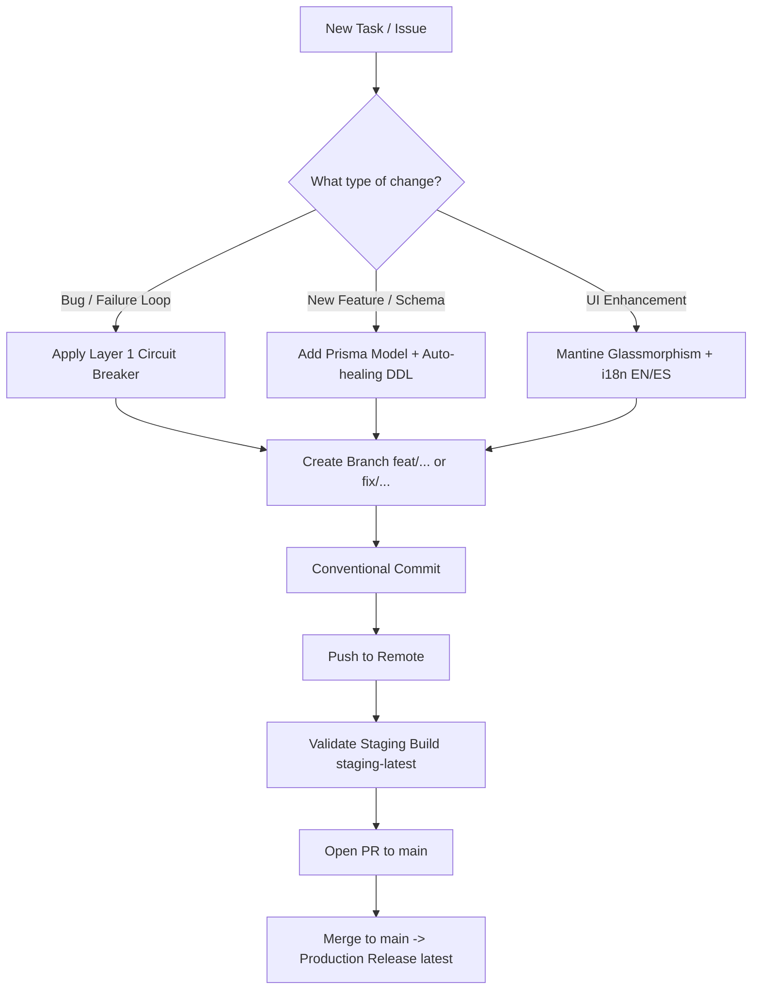

# Kaizen Architecture & Development Workflow

This skill standardizes the engineering workflow, resilient architecture principles, and delivery pipeline across Kaizen and sibling ecosystem repositories.

---

## ⚡ Core Philosophy & Simplicity Checklist

Before writing code or introducing complexity, run through this checklist in order and stop at the first "Yes":
1. **YAGNI:** Is this feature or abstraction strictly necessary right now?
2. **Reuse:** Does a similar mechanism already exist in the codebase? Reuse it.
3. **Deterministic First:** Can this problem be solved deterministically with zero token cost (Layer 1) before involving AI (Layer 2)?
4. **Standard Library / Native Frameworks:** Does the runtime or framework already provide this capability out of the box?
5. **Simplicity:** Keep the implementation as concise, robust, and readable as possible.

---

## 🏛️ The Four Pillars

### 1. Git Flow & Release Engineering
- **Golden Rule:** Never push functional code directly to `main`.
- **Feature Branches:** Always create dedicated branches off `origin/main` (`feat/<name>` or `fix/<name>`).
- **Conventional Commits:** `feat:`, `fix:`, `chore:`, `docs:`, `perf:`, `refactor:`.
- **Two-Tier Deployment:**
  1. *Staging:* Pushes to feature branches trigger `check.yml`, building multi-arch Docker image `staging-latest`. Validate on the live staging server (`http://192.168.20.28:3333`).
  2. *Production:* Pull Request created towards `main`. Once merged, `release-please.yml` generates changelogs, version bumps, and promotes to `latest`.
- 📖 [Detailed Git & Release Guide](./references/git-and-release.md)

### 2. Two-Layer Resilience Architecture
- **Layer 1: Deterministic Circuit Breaker (Zero Token Cost):**
  - Track consecutive failures (e.g. `attempts >= 3`).
  - Activate cooling pause (e.g. 24h cooldown `isPaused = true`, `pausedUntil = now + 24h`).
  - Discard job in BullMQ (`job.discard()`) to immediately halt infinite 2-minute retry loops.
  - Filter paused items from recurring scheduler sweeps (`checkChapters.ts`).
  - Magnitude and sanity guards against fuzzy match discrepancies (e.g., in `mangal.ts`).
  - Transparent state reset upon successful execution.
- **Layer 2: AI-Assisted Diagnostics & Self-Healing:**
  - Invoked on demand or upon persistent failures.
  - Provides root-cause analysis and discrete, 1-click remediation actions (`SWITCH_SOURCE`, `PAUSE_CHAPTER`, `FIX_FOLDER_DISCREPANCY`).
- 📖 [Two-Layer Resilience Guide](./references/two-layer-resilience.md)

### 3. Backend, Persistence & Self-Healing
- **Stateful Persistence:** Docker named volumes for stateful containers (`redis_data:/data` with AOF `--appendonly yes --save 60 1`, `db:/var/lib/postgresql/data`).
- **Startup Auto-Healing:**
  - Self-healing DDL in application startup (`settings-cache.ts` with `CREATE TABLE IF NOT EXISTS`) to prevent crashes in cold container boots.
  - Migration retry loops in `40-config` with fallback synchronization.
- **Pre & Post Validation:** Validate data integrity (e.g. CBZ magic bytes, file structure) before and immediately after operations, purging corrupt files prior to database commitment.
- 📖 [Backend & Persistence Guide](./references/backend-and-persistence.md)

### 4. UI/UX & Frontend Standards
- **Theme:** Indigo Glassmorphism with Mantine UI, ensuring high contrast in dark mode.
- **Hydration Safety:** Anti-flicker SSR hydration using `keepMounted={false}` on tabs and defensive fallback objects (`byChannel || {}`, `stats || {}`).
- **Responsiveness:** Horizontal scroll containers (`overflowX: 'auto'`) on data tables and dynamic viewport height (`100dvh`).
- **i18n Parity:** Every UI label must have corresponding keys in both English (`en/*.json`) and Spanish (`es/*.json`).
- 📖 [Frontend & UI Standards](./references/frontend-and-ui.md)

---

## 🛠️ Quick Decision Workflow

