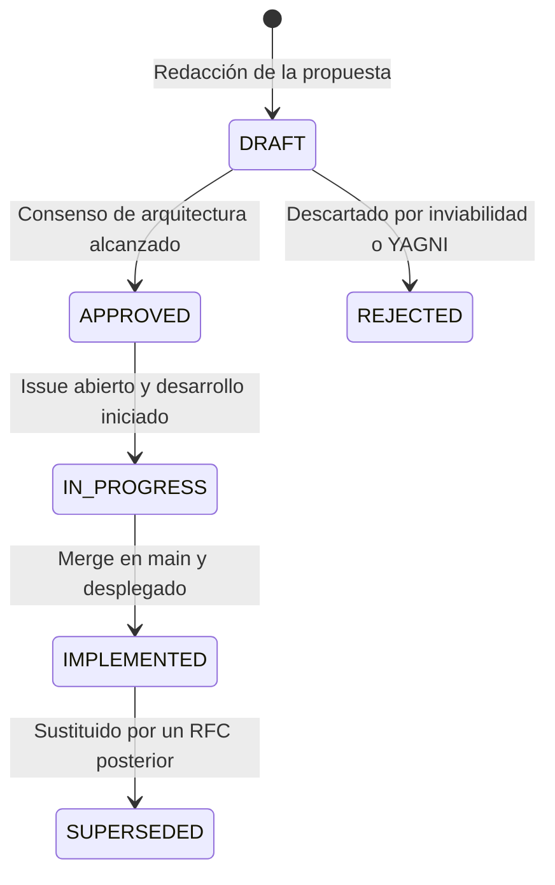

# [RFC 0000] Kaizen RFC Process & Architectural Governance

- **ID:** RFC 0000
- **Título:** Kaizen RFC Process & Architectural Governance (El Proceso de RFCs en Kaizen)
- **Estado:** 🟢 Activo / Canónico
- **Autor:** d4nj3s & Kaizen Core Team
- **Fecha:** 2026-11-01
- **Objetivo:** Establecer el estándar formal para proponer, evaluar, documentar e implementar cambios arquitectónicos sustanciales en el ecosistema Kaizen (Core Server, Web Reader, Extensiones iOS, y APIs).

---

## 1. Motivación y Propósito

El ecosistema de **Kaizen** opera en una intersección técnica crítica:
* Se ejecuta en entornos auto-alojados (*homelabs*) con restricciones de hardware extremas (desde Raspberry Pi y NAS Synology con 2GB de RAM hasta servidores multinúcleo en Proxmox).
* Provee servicios a múltiples clientes en tiempo real: Web Reader integrado, extensión de iOS (**Paperback**), e integraciones con servidores multimedia (**Kavita**, **Komga**).
* Gestiona bibliotecas locales masivas (de 100 GB a más de 1 TB) donde operaciones imprudentes de I/O o CPU pueden corromper datos o colapsar el host.

El objetivo de este proceso meta-RFC es **eliminar la improvisación técnica en decisiones de alto impacto**: garantizar que antes de alterar la base de datos, levantar nuevas colas en BullMQ o implementar transcodificadores, se evalúen los riesgos de rendimiento, resiliencia y compatibilidad.

---

## 2. ¿Cuándo es Obligatorio un RFC?

### ✅ Requiere RFC:
1. **Nuevos motores o colas de trabajo:** Introducción de nuevos workers o colas en BullMQ (ej. optimizadores de almacenamiento, transcodificadores, motores de sincronización externa).
2. **Alteraciones en Base de Datos:** Nuevas tablas o campos en `schema.prisma` que requieran migraciones y DDL de auto-sanación en arranque en frío.
3. **Cambios en APIs Públicas:** Modificación o adición de endpoints en `/api/v1/` que afecten a Paperback, lectores de terceros o integraciones con trackers (AniList, Mal).
4. **Perfiles de Rendimiento y Consumo de Hardware:** Cualquier feature que consuma más de 20% de CPU continua o impacte la memoria RAM del contenedor Docker.
5. **Modificaciones de Arquitectura de Resiliencia:** Alteraciones en Circuit Breakers (Capa 1) o motores de auto-reparación (Capa 2).

### ❌ NO Requiere RFC (Trámite directo vía Issue/PR estándar):
* Correcciones de errores (*bug fixes*) o parches de dependencias.
* Reparaciones o mejoras de scrapers individuales en Lua (`docker/mangal/sources/`).
* Mejoras estéticas o cosméticas en la UI (Glassmorphism, estilos Mantine, corrección de paddings).
* Nuevas traducciones en `public/locales/` que no alteren la funcionalidad base.

---

## 3. Anatomía Estándar de un RFC en Kaizen

Todo documento RFC debe residir en `docs/rfcs/NNNN-<slug>.md` (donde `NNNN` es un número secuencial de cuatro dígitos) y contener las siguientes secciones obligatorias:

1. **Cabecera de Metadatos:**
   * `ID:` RFC NNNN
   * `Título:` Nombre descriptivo
   * `Estado:` `DRAFT` | `APPROVED` | `IN_PROGRESS` | `IMPLEMENTED` | `REJECTED` | `SUPERSEDED`
   * `Autor:` Usuario o equipo proponente
   * `Fecha:` YYYY-MM-DD
   * `Objetivo:` Resumen en una sola frase del valor entregado.
2. **Motivación y Contexto:** Problema real que resuelve, métricas esperadas y alternativas descartadas (ej. por qué WebP y no .cb7).
3. **Principios de Diseño y Resiliencia:** Garantías de no interferencia con la lectura en streaming, operaciones atómicas y tolerancia a fallos.
4. **Perfiles de Rendimiento (Hardware Scalability):** Definición explícita de cómo se comportará la feature en hardware modesto (NAS/Raspberry) frente a servidores potentes.
5. **Impacto en Persistencia y Base de Datos:** Esquema Prisma propuesto y DDL de auto-sanación (`CREATE TABLE IF NOT EXISTS`).
6. **Arquitectura de Colas y Flujos:** Diagrama Mermaid de estados, prioridades de BullMQ y límites de reintentos con Circuit Breaker.
7. **Especificación de UI/UX e i18n:** Diseño en Mantine Glassmorphism y listado de claves de traducción en Español (`es`) e Inglés (`en`).
8. **Fases de Implementación:** Desglose incremental en pasos accionables.

---

## 4. Ciclo de Vida y Estados de un RFC



| Estado | Significado |
|---|---|
| 📝 `DRAFT` | Propuesta inicial en revisión abierta; abierta a comentarios y cambios en el diseño. |
| 🟡 `APPROVED` | Arquitectura aprobada por el mantenedor. Lista para ser desglosada en tareas. |
| 🔵 `IN_PROGRESS` | Existe un GitHub Issue activo y una rama `feat/...` en desarrollo. |
| 🟢 `IMPLEMENTED` | Código fusionado en `main`, validado en Staging y publicado en versión `latest`. |
| ⚪ `SUPERSEDED` | La solución fue reemplazada por una arquitectura más moderna (indicar RFC sucesor). |
| 🔴 `REJECTED` | Descartado formalmente (se conservan las razones documentadas en el propio RFC). |

---

## 5. La Cadena de Trazabilidad (Traceability Chain)

Para mantener orden absoluto y trazabilidad entre la discusión técnica y el código final, se sigue esta cadena obligatoria:

```text
[1. docs/rfcs/NNNN-<slug>.md]
             │
             ▼
[2. GitHub Tracking Issue] -> Título: feat(<area>): <Título> (RFC NNNN)
             │                Cuerpo: Checklists de fases [ ] vinculando al RFC
             ▼
[3. Feature Branch] --------> feat/<slug>
             │
             ▼
[4. Pull Request] ----------> Título: feat(<area>): <descripción>
             │                Footer: Closes #<Issue>, Ref: docs/rfcs/NNNN
             ▼
[5. Staging Validation] ----> Valida contenedor Docker staging-latest
             │
             ▼
[6. Production Release] ----> Merge en main -> release-please taggea release
```

### Reglas de Git y Commits:
* Los commits deben usar **Conventional Commits**: `feat(storage): ...`, `fix(storage): ...`.
* En la descripción de la Pull Request se debe indicar explícitamente:
  ```text
  Closes #<Número-de-Issue>
  Ref: docs/rfcs/NNNN-<slug>.md
  ```

---

## 6. Mantenimiento del Índice de RFCs

Cada nuevo RFC debe registrarse en la tabla índice de [`docs/rfcs/README.md`](./README.md). Cuando una feature pasa a producción, el estado en el archivo del RFC y en el índice se actualiza a `🟢 Implementado`.
