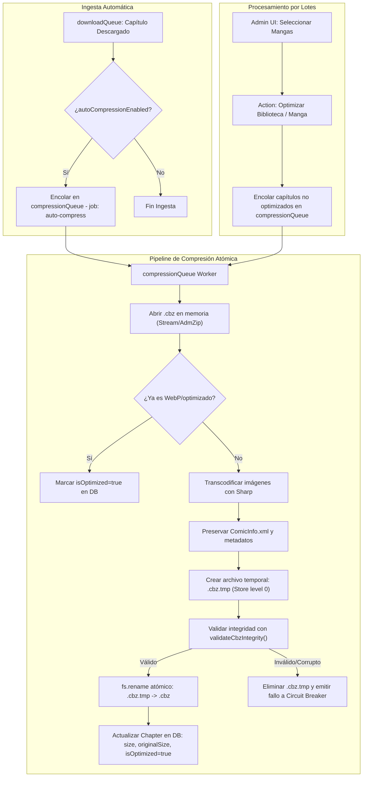

# [RFC 0001] Kaizen Storage Optimization Engine (CBZ to WebP Transcoding)

- **ID:** RFC 0001
- **Título:** Kaizen Storage Optimization Engine (CBZ to WebP Transcoding & Hardware Profiles)
- **Estado:** Propuesta / En Planificación
- **Autor:** d4nj3s & Comunidad Kaizen
- **Fecha:** 2026-11-01
- **Objetivo:** Reducción del 40% al 60% del almacenamiento en disco de bibliotecas manga mediante transcodificación interna de imágenes a WebP en archivos `.cbz`, compatible con ingesta automática y procesamiento por lotes de bibliotecas preexistentes.

---

## 1. Motivación y Contexto

En bibliotecas medianas y grandes (ej. 300 GB a más de 1 TB), el 95% de los archivos `.cbz` empaquetan imágenes en formato JPEG o PNG sin optimizar procedentes de los distintos scrapers.
* Los contenedores tradicionales como ZIP o 7z (`.cb7`) apenas logran una compresión adicional del 2% al 4% sobre imágenes ya comprimidas con pérdida.
* Los archivos sólidos (`.cb7`) introducen una penalización inaceptable de latencia y uso de memoria en servidores de lectura en streaming (**Paperback**, Web Reader integrado).
* La conversión interna a **WebP** (calidad visual imperceptible 80–85) reduce el tamaño de archivo entre un **35% y un 55%**, manteniendo la compatibilidad nativa con lectores externos (**Komga**, **Kavita**, **Tachiyomi/Mihon**, **Paperback**).

---

## 2. Principios de Diseño y Resiliencia

1. **Prioridad Absoluta de Lectura y Descarga:** La compresión nunca debe retrasar la lectura en streaming ni las descargas activas en curso.
2. **Reemplazo Atómico:** Ningún archivo original es sustituido hasta que el nuevo archivo `.cbz.tmp` haya superado la validación de integridad (`validateCbzIntegrity`).
3. **Persistencia en Base de Datos (Zero-Disk I/O en vistas):** El estado de optimización se almacena en PostgreSQL (`isOptimized`, `imageFormat`, `originalSize`). Las pantallas de Biblioteca nunca abren archivos en disco para determinar si están comprimidos.
4. **Perfiles de Rendimiento Ajustables (Hardware Scalability):** Prevención de congelamiento del host (OOM Killer) en NAS y mini PCs modestos mediante limitación de concurrencia y subprocesos.

---

## 3. Perfiles de Rendimiento (Hardware Profiles)

Configurable desde **Settings > Storage & Optimization**:

| Parámetro | 🟢 Resource Saver (Eco / NAS) | 🟡 Balanced (Recomendado) | 🔴 Extreme (Workstation / Proxmox) |
| :--- | :--- | :--- | :--- |
| **Escenario** | Raspberry Pi 4, NAS Synology/QNAP (2-4 núcleos, <4GB RAM) | Servidores domésticos (Intel Core i3/i5, 8–16GB RAM) | Servidores dedicados (Ryzen 7/9, i7/i9, 32GB+ RAM) |
| **Concurrencia BullMQ** | `1` capítulo a la vez | `1` capítulo a la vez | `3 - 4` capítulos paralelos |
| **Hilos libvips (`sharp`)** | `sharp.concurrency(1)` | `sharp.concurrency(2)` | `sharp.concurrency(0)` (todos los núcleos) |
| **Factor de Esfuerzo WebP** | `effort: 3` (Bajo consumo de CPU) | `effort: 4` (Equilibrio óptimo) | `effort: 6` (Máxima compresión) |
| **Calidad de Compresión** | `quality: 82` | `quality: 82` | `quality: 80` |
| **Pausa de Enfriamiento** | 1000 ms tras cada capítulo | 0 ms | 0 ms |
| **BullMQ Job Priority** | `priority: 15` (Baja) | `priority: 10` (Media-baja) | `priority: 5` |

---

## 4. Cambios en Base de Datos (Prisma Schema)

### 4.1 Modificaciones en `Chapter`
```prisma
model Chapter {
  id               Int      @id @default(autoincrement())
  // ... campos existentes ...
  size             Int      // Tamaño actual en bytes
  originalSize     Int?     // Tamaño original antes de la optimización
  isOptimized      Boolean  @default(false)
  imageFormat      String   @default("UNKNOWN") // "WEBP" | "AVIF" | "MIXED" | "JPEG"
  optimizedAt      DateTime?

  @@index([mangaId, isOptimized])
}
```

### 4.2 Modificaciones en `Settings`
```prisma
model Settings {
  id                         Int      @id @default(autoincrement())
  // ... campos existentes ...
  autoCompressionEnabled     Boolean  @default(false)
  compressionProfile         String   @default("BALANCED") // "RESOURCE_SAVER" | "BALANCED" | "EXTREME"
  compressionQuality         Int      @default(82)
  compressionFormat          String   @default("WEBP")     // "WEBP" | "AVIF"
  deleteOriginalOnSuccess    Boolean  @default(true)
}
```

> [!NOTE]
> Siguiendo el estándar de arquitectura de Kaizen, se incluirá DDL de auto-sanación (`CREATE TABLE IF NOT EXISTS` / `ALTER TABLE ADD COLUMN IF NOT EXISTS`) en el inicio del servidor para despliegues en contenedores sin migraciones manuales.

---

## 5. Arquitectura de Colas y Flujo de Trabajo

### 5.1 Cola Dedicada: `compressionQueue`
Se crea una cola independiente en BullMQ (`compressionQueue`) administrada por un worker dedicado en `src/server/queue/compression.ts`.



### 5.2 Capa de Resiliencia (Circuit Breaker Layer 1)
* Si un capítulo específico falla 3 veces en compresión (ej. archivo protegido o corrupto de origen):
  * Se marca con `metadataError = 'COMPRESSION_FAILED'`.
  * Se descarta de la cola con `job.discard()` para evitar bucles infinitos de CPU.
  * El archivo original permanece intacto.

---

## 6. Especificación de UI/UX (Frontend Mantine)

### 6.1 Vista de Biblioteca (`/library`)
* **Filtros rápidos en cabecera:**
  * `Todos` | `Sin Optimizar` | `Optimizados` | `En Progreso`
* **Columna / Indicador en Manga Card:**
  * Badge de almacenamiento: `1.4 GB (WebP)` vs `3.8 GB (JPG)`.
  * Barra de progreso si el manga está siendo procesado: `Optimizando 45/180`.
* **Acciones en lote:**
  * Modo selección múltiple (checkboxes de mangas) $\rightarrow$ Botón **"Optimizar espacio seleccionados"**.

### 6.2 Vista de Detalle del Manga (`/mangas/:id`)
* Métrica en cabecera: **Espacio en disco:** `2.1 GB` | **Ahorro potencial estimado:** `~1.0 GB`.
* Botón de acción: **"Optimizar manga"** (con modal de confirmación y selector de perfil).
* Si hay un trabajo en curso: Botón para pausar o cancelar la optimización de esa serie.

### 6.3 Ajustes de Almacenamiento (`/settings`)
* **Pestaña nueva: "Almacenamiento y Optimización"**:
  * Toggle: `Optimizar automáticamente nuevos capítulos descargados`.
  * Selector de Perfil:
    * 🟢 *Resource Saver (Bajo impacto en NAS)*
    * 🟡 *Balanced (Recomendado)*
    * 🔴 *Extreme (Servidores potentes)*
  * Tarjeta de Resumen Global:
    * 📦 Espacio total de biblioteca: `480.2 GB`
    * 🚀 Espacio ahorrado con WebP: `198.6 GB`
    * 📊 Porcentaje optimizado: `58% (3,240 / 5,580 capítulos)`

### 6.4 Paridad de Internacionalización (i18n)
Nuevas claves en `public/locales/es/common.json` y `public/locales/en/common.json`:
* `storage.compression.title`: "Optimización de Almacenamiento" / "Storage Optimization"
* `storage.compression.profile.saver`: "Ahorro de Recursos (NAS / Eco)" / "Resource Saver (NAS / Eco)"
* `storage.compression.profile.balanced`: "Equilibrado" / "Balanced"
* `storage.compression.profile.extreme`: "Extremo (Alto consumo)" / "Extreme (High usage)"
* `storage.compression.savedSpace`: "Espacio Ahorrado" / "Space Saved"

---

## 7. Fases de Implementación Propuestas

1. **Fase 1 (CLI Scratch Engine):** Crear un script `scripts/optimize-library.ts` independiente para validar la tasa de compresión y velocidad en lotes reales sin impacto en el servidor.
2. **Fase 2 (Prisma & Worker BullMQ):** Agregar campos al esquema Prisma y levantar la cola `compressionQueue` con soporte de los 3 perfiles de hardware.
3. **Fase 3 (Triggers automáticos):** Conectar el final exitoso de `downloadQueue` con la encolación condicional de compresión.
4. **Fase 4 (UI & Dashboard):** Incorporar los controles de selección múltiple en Biblioteca, ajustes de perfil en Settings y estadísticas de ahorro de espacio.
