# [RFC 0002] Canonical Identity, Folder Reuse & Library Deduplication Audit

- **ID:** RFC 0002
- **Título:** Canonical Identity, Folder Reuse & Library Deduplication Audit (Identidad Canónica, Reutilización de Carpetas y Auditoría de Deduplicación en Disco)
- **Estado:** 📝 DRAFT
- **Autor:** d4nj3s & Kaizen Core Team
- **Fecha:** 2026-11-03
- **Objetivo:** Establecer un sistema de identidad unificada para mangas basado en AniList (u otros metadatatraders) que permita enrutar múltiples nombres a una misma carpeta física en disco, junto con una herramienta de auditoría para detectar y limpiar carpetas huérfanas y fusionar duplicados.

---

## 1. Motivación y Contexto

A medida que una biblioteca de Kaizen crece (con decenas o cientos de obras y gigabytes de almacenamiento local):
1. **Divergencia de Nombres entre Scrapers:** Cuando una fuente original (ej. MangaDex) deja de funcionar y el usuario migra a otra (ej. MGEKO o WeebCentral), la nueva fuente suele utilizar títulos distintos (nombre oficial en inglés vs. romanización japonesa vs. traducción literal de fansub). Esto provoca que Mangal descargue los nuevos capítulos en una carpeta diferente, fragmentando la obra en dos directorios separados.
2. **Carpetas Huérfanas en Almacenamiento:** Cuando se elimina un manga de la base de datos sin seleccionar "Eliminar archivos", o cuando una descarga falla a mitad de proceso, quedan carpetas abandonadas en el disco consumiendo gigabytes de espacio sin que Kaizen las gestione.
3. **Duplicados Inadvertidos:** Los usuarios pueden agregar el mismo manga dos veces sin darse cuenta debido a diferencias ortográficas o idiomáticas (ej. *Katainaka no Ossan, Kensei ni Naru* y *From Old Country Bumpkin to Master Swordsman*), malgastando ancho de banda y espacio de almacenamiento.
4. **Impacto en Servidores Multimedia:** Servidores externos como Kavita o Komga muestran series divididas en múltiples fichas incompletas cuando los capítulos están repartidos en carpetas distintas.

---

## 2. Principios de Diseño y Resiliencia

1. **Principio de Identidad Canónica (Single Source of Truth):**
   * El nombre de una obra en un scraper es solo un *transporte*, no su identidad. La identidad real es el ID de metadatos externo (AniList ID / MangaDex ID / MAL ID).
   * La carpeta en disco (`libraryPath / sanitize(manga.title)`) es el repositorio físico único de todos los capítulos, independientemente de qué scraper proporcione cada capítulo.

2. **Cero Borrado Ciego (Dry-Run Obligatorio):**
   * Cualquier acción de auditoría o limpieza de disco debe ofrecer siempre una vista previa interactiva (*Dry-Run*).
   * Kaizen nunca eliminará una carpeta sin confirmación explícita del usuario o sin verificar que su contenido ya existe en la carpeta canónica.

3. **Operaciones de Fusión Atómicas y Seguras:**
   * La fusión de dos mangas duplicados no sobreescribe capítulos existentes a menos que el nuevo archivo sea verificado mediante checksum o tamaño mayor y válido.
   * Los movimientos de archivos se realizan a nivel de sistema de archivos (`fs.rename`), garantizando que si falla la operación, ningún archivo se corrompa.

4. **No Interferencia con Lecturas Activas:**
   * Las tareas de escaneo de disco se ejecutan con prioridad baja en BullMQ y ceden CPU/IO (`yield`) periódicamente para no ralentizar el Web Reader ni el streaming a Paperback/Kavita.

---

## 3. Arquitectura del Sistema

```mermaid
flowchart TD
    subgraph Ingestion["1. Reconocimiento y Descarga"]
        Input["Nuevo Manga / Migración"] --> CheckAniList["Consulta de Alias en AniList / Metadatos"]
        CheckAniList --> MatchExists{"¿Existe obra con el\nmismo AniList ID o Alias?"}
        MatchExists -- "Sí" --> BindSource["Vincular fuente como MangaSource alternativo\nReutilizar Manga existente"]
        MatchExists -- "No" --> CreateManga["Crear nuevo Manga"]
        
        Download["Worker de Descarga (Mangal)"] --> DownTmp["Descarga temporal en disco"]
        DownTmp --> Router["Router Post-Descarga:\nMover .cbz a /library/Manga_Canonico/"]
    end

    subgraph AuditEngine["2. Motor de Auditoría y Limpieza (Disk Audit)"]
        ScanTrigger["Ejecución Manual o Programada"] --> DiskScan["Escanear directorios físicos en Library.path"]
        DiskScan --> CompareDB["Comparar contra registros en Prisma (Manga.title)"]
        CompareDB --> OrphanDir["Detectar Carpetas Huérfanas (En disco pero no en BD)"]
        CompareDB --> DuplicateManga["Detectar Obras Duplicadas (Mismo AniList ID o Alias cruzado)"]
        
        OrphanDir --> Report["Generar Reporte de Auditoría (Dry-Run)"]
        DuplicateManga --> Report
        
        Report --> AdminAction{"Acción del Administrador"}
        AdminAction -- "Importar Huérfana" --> ImportManga["Crear Manga en BD a partir de carpeta"]
        AdminAction -- "Eliminar Huérfana" --> DeleteDir["Borrar archivos residuales de disco"]
        AdminAction -- "Fusionar Duplicados" --> MergeManga["Mover capítulos a Carpeta A y consolidar BD"]
    end
```



---

## 4. Perfiles de Rendimiento y Escalabilidad

| Perfil de Hardware | Estrategia de Escaneo de Disco | Concurrencia de Auditoría | Límite de Memoria RAM |
|---|---|---|---|
| **Eco / NAS (Synology, RPi 4)** | Escaneo por lotes de 20 carpetas con pausas de 100ms (`sleep`) entre lecturas de I/O para no saturar discos mecánicos HDD. | 1 worker concurrente, BullMQ `concurrency: 1`. | < 64 MB heap asignado al escaneo. |
| **Estándar / Homelab (Intel N100, VMs)** | Escaneo asíncrono con `fs.promises.readdir` en lotes de 50 carpetas. | 2 workers concurrentes. | < 128 MB heap. |
| **Alto Rendimiento (NVMe, Servidor Dedicado)** | Escaneo paralelo rápido con verificación de hash en streaming. | 4 workers concurrentes. | < 256 MB heap. |

---

## 5. Impacto en Persistencia y Base de Datos

### Cambios propuestos en `schema.prisma`:

```prisma
model Manga {
  id                    Int           @id @default(autoincrement())
  // ... campos existentes ...
  anilistId             Int?          // ID único externo de AniList para deduplicación estricta
  malId                 Int?          // ID opcional de MyAnimeList
  folderName            String?       // Nombre de la carpeta física en disco (si difiere de title)

  @@index([anilistId])
}

model DiskAuditFinding {
  id          Int      @id @default(autoincrement())
  createdAt   DateTime @default(now())
  libraryId   Int
  type        String   // "ORPHAN_FOLDER" | "DUPLICATE_MANGA" | "MISMATCHED_FOLDER"
  path        String
  sizeBytes   BigInt   @default(0)
  targetMangaId Int?   // Si es duplicado o coincide con un manga existente
  details     Json?    // Metadatos adicionales (capítulos detectados, títulos sugeridos)
  status      String   @default("PENDING") // "PENDING" | "RESOLVED" | "IGNORED"

  @@index([libraryId, status])
}
```

### Auto-Sanación DDL (Zero-Downtime Migration):
En `settings-cache.ts`, añadir durante el arranque en frío:
```sql
ALTER TABLE "Manga" ADD COLUMN IF NOT EXISTS "anilistId" INTEGER;
ALTER TABLE "Manga" ADD COLUMN IF NOT EXISTS "malId" INTEGER;
ALTER TABLE "Manga" ADD COLUMN IF NOT EXISTS "folderName" TEXT;
CREATE TABLE IF NOT EXISTS "DiskAuditFinding" (
  "id" SERIAL PRIMARY KEY,
  "createdAt" TIMESTAMP(3) NOT NULL DEFAULT CURRENT_TIMESTAMP,
  "libraryId" INTEGER NOT NULL,
  "type" TEXT NOT NULL,
  "path" TEXT NOT NULL,
  "sizeBytes" BIGINT NOT NULL DEFAULT 0,
  "targetMangaId" INTEGER,
  "details" JSONB,
  "status" TEXT NOT NULL DEFAULT 'PENDING'
);
```

---

## 6. Especificación de UI/UX e i18n

### Vista de Auditoría (Pestaña "Auditoría de Almacenamiento" en Mantenimiento):
1. **Resumen de Salud del Almacenamiento:**
   * Métrica de espacio recuperable (ej. `3.4 GB en carpetas huérfanas`).
   * Contador de posibles duplicados detectados (ej. `2 series duplicadas`).
2. **Tabla de Acciones del Dry-Run:**
   * **Carpetas Huérfanas:** Muestra el nombre de la carpeta en disco, tamaño, número de archivos `.cbz` encontrados, y botones para:
     * `[Vincular / Importar a Biblioteca]`: Crea la ficha en Kaizen sin re-descargar.
     * `[Eliminar Definitivamente]`: Libera el espacio en disco.
   * **Mangas Duplicados:** Muestra el Manga A (canónico) y el Manga B (alias), comparando sus capítulos. Botón:
     * `[Fusionar y Consolidar]`: Mueve todos los capítulos de B a la carpeta de A, reasigna lecturas y elimina la ficha redundante de B.

### Claves de Traducción requeridas (`public/locales/`):
* **Español (`es/common.json`):**
  * `maintenance.audit.title`: "Auditoría y Limpieza de Almacenamiento"
  * `maintenance.audit.orphansFound`: "Se encontraron {{count}} carpetas huérfanas ocupando {{size}}"
  * `maintenance.audit.duplicatesFound`: "Se detectaron {{count}} mangas potencialmente duplicados"
  * `maintenance.audit.mergeBtn`: "Fusionar en carpeta canónica"
  * `maintenance.audit.cleanBtn`: "Limpiar espacio en disco"
* **Inglés (`en/common.json`):**
  * `maintenance.audit.title`: "Storage Audit & Deduplication"
  * `maintenance.audit.orphansFound`: "Found {{count}} orphaned folders using {{size}}"
  * `maintenance.audit.duplicatesFound`: "Detected {{count}} potentially duplicated mangas"
  * `maintenance.audit.mergeBtn`: "Merge into canonical folder"
  * `maintenance.audit.cleanBtn`: "Clean up disk space"

---

## 7. Fases de Implementación

- [ ] **Fase 1: Enrutamiento de Descargas a Carpeta Canónica**
  - Implementar en `download.ts` el post-procesamiento de descargas para que Mangal siempre consolide los archivos `.cbz` en `library.path / sanitize(manga.title)`.
  - Garantizar que si un `MangaSource` tiene un nombre diferente al `manga.title`, la carpeta física resultante no se bifurque.

- [ ] **Fase 2: Motor de Auditoría de Disco (Read-Only / Dry-Run)**
  - Crear worker `libraryAuditWorker` en BullMQ con perfiles de escalabilidad de I/O.
  - Implementar scanner que recorra el directorio raíz de cada biblioteca y coteje contra la tabla `Manga`.
  - Cruzar `synonyms` y AniList IDs para agrupar obras duplicadas en memoria.

- [ ] **Fase 3: Procedimientos de Fusión y Limpieza Segura**
  - Endpoints tRPC `manga.audit.scan`, `manga.audit.cleanOrphans`, y `manga.audit.mergeDuplicates`.
  - Interfaz de usuario interactiva en la sección de Mantenimiento con alertas de seguridad y confirmación antes de cualquier borrado.
  - Notificaciones al usuario y eventos para actualizar Kavita/Komga tras la consolidación de carpetas.
