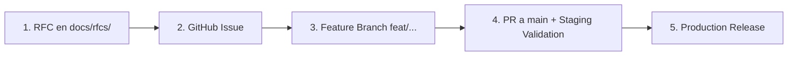

# 📜 Kaizen RFCs (Requests for Comments)

Este directorio contiene las **Propuestas de Arquitectura y Especificaciones Técnicas (RFCs)** del ecosistema **Kaizen**.

---

## 🎯 ¿Qué es un RFC en Kaizen?

Un **RFC (Request for Comments)** es un documento de diseño técnico formal que describe un cambio arquitectónico sustancial, un nuevo motor del sistema, alteraciones en el esquema de base de datos o features complejas antes de escribir código.

### Objetivos:
1. **Alinear diseño antes de picar código:** Analizar alternativas, riesgos de rendimiento (CPU/RAM/IO) y compatibilidad (Paperback, Komga, Kavita).
2. **Preservar la memoria histórica:** Saber por qué se tomaron ciertas decisiones técnicas y no otras (ej. por qué WebP y no .cb7).
3. **Servir de base para Issues y PRs:** Cada RFC aprobado se desglosa en uno o varios Issues en GitHub para su implementación paso a paso.

---

## 🔄 El Ciclo de Vida de una Feature (RFC Workflow)

1. **Propuesta (RFC):** Se crea un archivo `docs/rfcs/NNNN-nombre-de-la-propuesta.md` con numeración secuencial (0001, 0002, etc.).
2. **Creación del Issue:** Cuando el RFC está listo para implementarse, se abre un **GitHub Issue** enlazando al RFC:
   * Título: `feat(storage): Implement Storage Optimization Engine (RFC 0001)`
   * Se desglosan las fases del RFC en checklists `[ ]` dentro del issue.
3. **Desarrollo en Rama Dedicada:** Se crea una rama `feat/<nombre>` (ej. `feat/storage-optimization`).
4. **Pull Request:** Se abre una PR apuntando a `main` vinculando el issue (`Closes #123` / `Ref: docs/rfcs/0001-storage-optimization-engine.md`).
5. **Validación en Staging:** Se prueba la imagen Docker `staging-latest` en servidor de staging antes de fusionar.
6. **Promoción a Producción:** Al hacer merge a `main`, `release-please` genera el changelog y la versión final.

---

## 📋 Índice de RFCs

| ID | Título | Estado | Autor | Fecha |
|---|---|---|---|---|
| [RFC 0000](./0000-rfc-process.md) | Kaizen RFC Process & Architectural Governance (El Proceso de RFCs) | 🟢 Canónico / Activo | d4nj3s | 2026-11-01 |
| [RFC 0001](./0001-storage-optimization-engine.md) | Storage Optimization Engine (CBZ to WebP Transcoding & Hardware Profiles) | 🟡 Propuesta / Aprobado | d4nj3s | 2026-11-01 |
| [RFC 0002](./0002-canonical-identity-and-library-deduplication.md) | Canonical Identity, Folder Reuse & Library Deduplication Audit | 📝 DRAFT / Propuesta | d4nj3s | 2026-11-03 |
